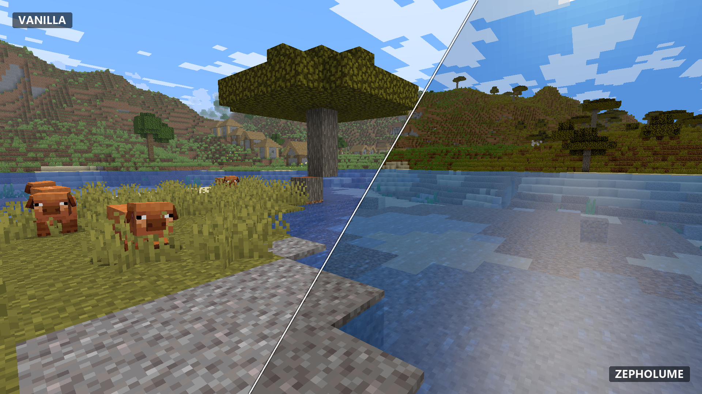

# Zepholume Shaders

Zepholume is a lightweight shader pack for **Minecraft Java Edition** that focuses on lighting, fog, clouds and water. It uses a direct rendering path without shadow maps or expensive post-processing pipelines.



> Archived comparison illustrating the visual style; not a V1.0.8 test.

## V1.0.8

The V1.0.8 source was finalized for local export on November 25, 2026. It is available in this repository. The latest ZIP in the repository's `Releases/` directory is still V1.0.7; check CurseForge for published downloads.

- [CurseForge files](https://www.curseforge.com/minecraft/shaders/zepholume-shaders/files) · [GitHub ZIP archives](Releases/)
- [V1.0.8 release and build instructions](Zepholume-Shaders/docs/V1.0.8_RELEASE.md) · [Changelog](Zepholume-Shaders/CHANGELOG.md)
- Recorded SHA-256 of the locally exported `Zepholume-Shaders-1.0.8.zip`: `A4C733D2ACB89A7BCBD158A40BF19B114D02B8A357AA9EFA7E97AC1262E0D804`

### What's new

- Shared Overworld horizon colours across sky, terrain fog and clouds; upper profiles add moon-directed cloud lighting and distance-faded cloud detail.
- Calmer nighttime water, directional twilight reflections, lightmapped transmission under cover and no analytical sky reflections in the Nether.
- Restored hurt/flash tints, refined enclosed block-light warmth and neutral distant terrain shading.
- More stable foliage and water animation across camera-coordinate resets.
- Cheaper Potato/Low paths, with less work before fog starts and after distant ripples fade.

V1.0.8 has offline GLSL, standalone loader-patcher and packaging evidence, not Minecraft gameplay or visual qualification. Four Iris/Oculus patcher lanes were exercised. Synthetic GPU timings are not gameplay FPS measurements. See [compatibility](docs/COMPATIBILITY.md) and [CI status](docs/CI_AND_RELEASE_QUALIFICATION.md).

## Features

- Atmospheric sky, lighting, fog, clouds and weather
- Controlled exposure, contrast, colour temperature and material response
- Restrained water shading and optional low-amplitude waves
- Five compile-time quality tiers
- Maintainable shared GLSL 330-compatible source

The renderer intentionally avoids shadow maps, SSR, SSAO, bloom pipelines, temporal history/TAA, volumetric pipelines, ray tracing, compute shaders and additional full-resolution colour passes.

## Quality profiles

| Profile | Intended use | Highlights |
| --- | --- | --- |
| **Potato** | Minimal work / compatibility triage | Scene grade, loader sky and fog; optional analytical work disabled |
| **Low** | Weaker hardware | Bounded face, cloud, weather and water treatment |
| **Balanced** | **Default / recommended** | Material response, atmospheric depth and subtle water waves |
| **High** | More GPU headroom | Refined water, ambient and cloud response |
| **Ultra** | Maximum analytical quality | Highest detail within the same direct-path renderer |

`Ultra Lite` remains a deprecated alias for Low, not a sixth selectable profile. The five profiles are defined in source; local Iris profile switching evidence belongs to V1.0.7, not the V1.0.8 ZIP. See [Profiles](docs/PROFILES.md).

## Installation

1. Prepare a Minecraft Java instance with a compatible **Iris** loader, or **Oculus** where available.
2. Choose an available ZIP from [CurseForge Files](https://www.curseforge.com/minecraft/shaders/zepholume-shaders/files) or [GitHub archives](Releases/). To build V1.0.8, follow the [release instructions](Zepholume-Shaders/docs/V1.0.8_RELEASE.md).
3. Copy the intact ZIP to **that instance's** `shaderpacks` directory. Do **not** extract it.
4. Select Zepholume in the shader menu and start with **Balanced**.
5. On errors or visual corruption, keep the full `latest.log` and retest in an isolated instance.

The development target is Minecraft Java 1.20–26.3 with Iris and an Oculus compatibility path. This is not a tested-version list. V1.0.7 has historical Iris/Intel runtime evidence; V1.0.8 has no exact-ZIP gameplay test. OptiFine is unsupported.

See [Installation](docs/INSTALLATION.md), [Compatibility](docs/COMPATIBILITY.md) and [Troubleshooting](docs/TROUBLESHOOTING.md).

## Documentation

- [Installation](docs/INSTALLATION.md)
- [Compatibility & evidence](docs/COMPATIBILITY.md)
- [Quality Profiles](docs/PROFILES.md)
- [Architecture](docs/ARCHITECTURE.md)
- [Troubleshooting](docs/TROUBLESHOOTING.md)
- [Known issues and test gaps](Zepholume-Shaders/docs/KNOWN_ISSUES.md)
- [Development](docs/DEVELOPMENT.md)
- [CI and release qualification](docs/CI_AND_RELEASE_QUALIFICATION.md)
- [V1.0.8 release and validation](Zepholume-Shaders/docs/V1.0.8_RELEASE.md)
- [Historical V1.0.7 final release report](Zepholume-Shaders/docs/V1.0.7_FINAL_RELEASE.md)
- [Source and developer tooling](Zepholume-Shaders/)

## Repository layout

```text
Zepholume-Shaders/
├─ README.md                 Public overview
├─ docs/                     Guides and qualification status
├─ Screenshots/              Archival comparison images
├─ Releases/                 Versioned ZIP archives
├─ Zepholume-Shaders/        Shader source and developer tooling
├─ curseforge-description.html
├─ LICENSE
└─ NOTICE
```

## Reporting a bug

Include the shader version, Minecraft and loader versions, profile, GPU/driver, Java, rendering mods, reproduction steps and a sanitized `logs/latest.log`. For visual bugs, add a screenshot and describe what looks wrong. Include the ZIP SHA-256 if available; save the log before restarting Minecraft. Use [GitHub Issues](https://github.com/SoumyajitXD/Zepholume-Shaders/issues).

## License

Copyright © 2026 Soumyajit Biswas. Licensed under [Apache License 2.0](LICENSE).
