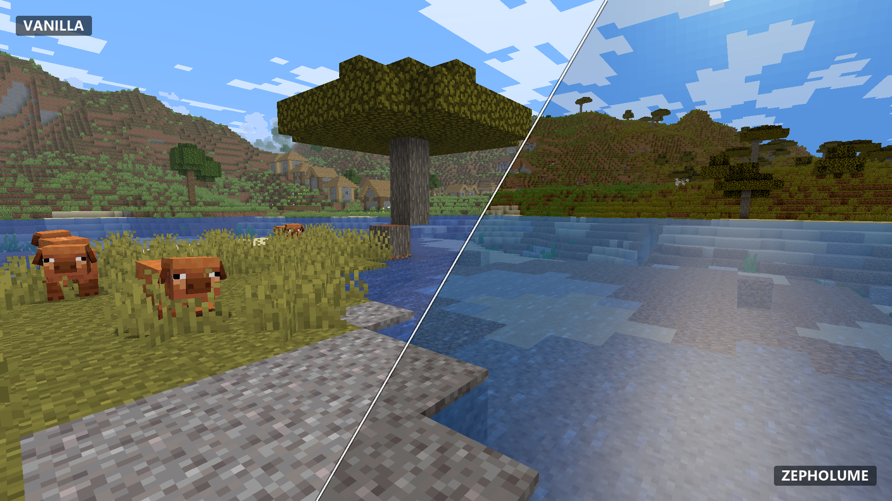

# Zepholume Shaders

**Atmospheric lighting. Polished visuals. Practical performance.**

Zepholume Shaders is a performance-conscious shader pack for **Minecraft Java Edition**. It is built to make Minecraft feel richer, deeper, and more atmospheric without treating frame rate as disposable.



## Current release

**V1.0.5 shader source published — runtime qualification: READY: NO.**

The [V1.0.5 Phase 10 source tree](Zepholume-Shaders/) was pushed to `main` from `Zepholume-Shaders-1.0.5-dev-phase10.zip` (SHA-256 `4B3803CF87AF43952CF91D145BB634C3346DEF6FC8C7008C37368058DC75DC91`). The final-named `Zepholume-Shaders-1.0.5.zip` was **absent from this repository's `Releases/` folder** at the source-push audit. Check [CurseForge Files](https://www.curseforge.com/minecraft/shaders/zepholume-shaders/files) for actual downloadable versions; the [V1.0.4 ZIP](Releases/Zepholume-Shaders-1.0.4.zip) remains available here.

**Evidence boundary:** Minecraft 1.20.1 Fabric/Iris 1.7.6 + Sodium 0.5.13 and Forge/Oculus 1.8.0 + Embeddium 0.3.31 (Java 17) have staged test lanes, **not** completed launch/render QA. Minecraft 26.2 Iris Fabric/NeoForge is a static target; the experimental Forge/Oculus Community Port lane has incomplete world-program coverage. Other versions are not automatically supported. OptiFine remains untested/unsupported.

## What's new in V1.0.5

- Restores the loader-provided per-surface lightmap multiplication on lit scene paths to address the source-level cause of full-bright caves and interiors.
- Adjusts skylight attenuation and low-light/contrast behaviour, targeting the black crush and day/night imbalance identified in earlier screenshots.
- Restores dimension wrapper sets and loader texture-matrix transforms, limits analytical water effects to classified Minecraft water, and preserves loader fog handling for lava/powder-snow media.
- Keeps five selectable profiles (Potato, Low, Balanced, High, Ultra), with Balanced as default; High/Ultra no longer force extra contrast or saturation.
- Repairs Iris-compatible shader-option tooltip keys and retains the direct GLSL 330, single-colour-target design.

Phase 10 local validation reported **272/272 GLSL stages, 420/420 links, and 630/630 mocked portability cases**. The first hosted V1.0.5 GitHub Actions run passed Linux regression, GLSL, portability, and package jobs but **failed Windows source validation** (`Invalid profile assignment in Potato`). The workflow now attempts to correct Windows checkout line endings; that fix needs a new hosted run before claiming green CI.

**Important:** loader-patched compilation, in-world visual correctness, visible profile selection, measured FPS, and full cross-version compatibility are **not yet verified**. Source publication is not runtime release qualification.

## What Zepholume focuses on

- Atmospheric lighting and environmental colour
- Controlled exposure, contrast, temperature, and scene depth
- Refined fog, sky, cloud, weather, water, and underwater treatment
- Multiple quality profiles with real compile-time capability boundaries
- Stable frame pacing and bounded rendering cost
- A deliberately maintainable shared-GLSL architecture
- Broad GLSL portability rather than vendor-specific tricks

Zepholume does **not** chase a feature checklist at any cost. The rendering design stays intentionally lean: no shadow-map pipeline, SSR, SSAO, bloom pipeline, temporal history/TAA, volumetric pipeline, ray tracing, compute shaders, geometry/tessellation stages, SSBO/image pipeline, or a pile of extra full-resolution colour buffers.

## Quality profiles

| Profile | Intended use | Direct-path behaviour |
| --- | --- | --- |
| **Potato** | Weak/integrated GPUs and compatibility triage | Direct grade and loader sky/fog; analytical face/material/cloud/water/weather/underwater-colour work compiled out |
| **Low** | Lower-end hardware | Directional face/cloud response, bounded analytical water/weather, subtle underwater fog tint |
| **Balanced** | General gameplay | Default; adds stronger material response, atmospheric depth, two-wave water movement, and skylight occlusion for downward/overhung facets |
| **High** | Systems with more headroom | Adds higher bounded detail, dual-hemisphere ambient fill, refined fifth-power water response, and cloud solar-rim treatment |
| **Ultra** | Maximum current Zepholume quality | Maximum bounded analytical tiers within the same direct-path architecture; still no shadow/post/temporal renderer expansion |

`Balanced` is the default and recommended starting point. `Ultra Lite` remains a deprecated compatibility alias for Low. See [Profiles](docs/PROFILES.md).

## Installation

1. For the strongest current evidence baseline, use a **Minecraft 1.20.1** instance with the staged Iris or Oculus stack documented above.
2. Download `Zepholume-Shaders-1.0.5.zip` from [CurseForge Files](https://www.curseforge.com/minecraft/shaders/zepholume-shaders/files) **only when it is actually listed**. The repository currently holds the V1.0.5 source, not a final V1.0.5 ZIP; [V1.0.4](Releases/Zepholume-Shaders-1.0.4.zip) remains available.
3. Put the ZIP directly in that instance's `shaderpacks` folder.
4. Open Minecraft's shader-pack menu and select **Zepholume Shaders**.
5. Start with the **Balanced** profile, then tune down or up for your hardware.

Do not extract the release ZIP. For compatibility testing, prefer a disposable or isolated instance over an irreplaceable modpack save.

Minecraft 26.2 lanes are currently **static/experimental evidence**, not equivalent to the staged 1.20.1 baseline. See the compatibility documentation before treating them as supported runtime configurations.

Full instructions: [Installation Guide](docs/INSTALLATION.md)

## Compatibility and validation status

V1.0.5 has strong **static/source and numerical regression validation** but incomplete **runtime qualification**; the initial hosted Windows CI source-validation job failed.

The maintained source pipeline validates profile/dimension behaviour, standalone GLSL compilation, architectural boundaries, and release-specific mathematical invariants. That can catch source, preprocessor, interface, arithmetic, and architecture regressions; it cannot establish loader-patched compilation, driver behaviour, visual correctness, or measured performance.

See [Compatibility](docs/COMPATIBILITY.md) for the public compatibility boundary.

## Documentation

- [Installation](docs/INSTALLATION.md)
- [Compatibility](docs/COMPATIBILITY.md)
- [Quality Profiles](docs/PROFILES.md)
- [Architecture](docs/ARCHITECTURE.md)
- [Troubleshooting](docs/TROUBLESHOOTING.md)
- [Development](docs/DEVELOPMENT.md)
- [CI and release qualification](docs/CI_AND_RELEASE_QUALIFICATION.md)
- [Shader source and developer tooling](Zepholume-Shaders/)

## Repository layout

```text
Zepholume-Shaders/
├─ README.md                 Project overview
├─ docs/                     Public project documentation
├─ Screenshots/              Comparison screenshots
├─ Releases/                 Release archives
├─ Zepholume-Shaders/        Shader source and development tooling
├─ curseforge-description.html
├─ LICENSE
└─ NOTICE
```

## Design philosophy

A beautiful still image is not enough if moving the camera turns the game into a slideshow. Zepholume treats performance, stability, portability, and maintainability as part of visual quality—not cleanup work for later.

The project prefers bounded analytical effects, shared GLSL libraries, compile-time quality control, and simple rendering paths over architecture cosplay and expensive effects with poor visual return.

## Development status

Zepholume is actively developed. Visual tuning, optimisation, compatibility work, and architecture improvements may continue between releases. Screenshots represent the shader at the time they were captured and can differ slightly from later builds.

## License

Copyright © 2026 Soumyajit Biswas.

Licensed under the [Apache License 2.0](LICENSE).
