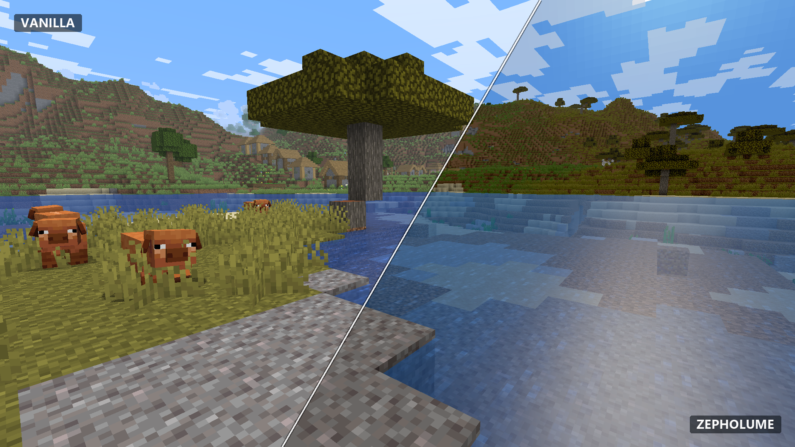

# Zepholume Shaders

**Atmospheric lighting. Polished visuals. Practical performance.**

Zepholume Shaders is a performance-conscious shader pack for **Minecraft Java Edition**. Its direct-path renderer focuses on atmospheric light, restrained colour, water and environmental detail without adding expensive shadow, reflection or post-processing pipelines.



> Archival visual comparison; not a verified V1.0.7 before/after capture.

## Current source release: V1.0.7

**The V1.0.7 source and final distributable ZIP are available in this GitHub repository.** The release was finalized locally on 2026-11-07 with explicit compatibility and performance limitations.

- **Download:** [Zepholume-Shaders-1.0.7.zip](Releases/Zepholume-Shaders-1.0.7.zip)
- **Release record:** 67,750 bytes, 137 archive entries
- **Reported SHA-256:** `79CF6F63E7BA609D734FE653A34321BB79DC5EBAFCC80C1FD5A190471EC5BEB8`
- **Shader source:** [Zepholume-Shaders/](Zepholume-Shaders/)
- **Release notes:** [V1.0.7 release notes](Zepholume-Shaders/docs/V1.0.7_RELEASE_NOTES.md)
- **Verification report:** [V1.0.7 final release](Zepholume-Shaders/docs/V1.0.7_FINAL_RELEASE.md)
- **CurseForge:** [Check files actually available there](https://www.curseforge.com/minecraft/shaders/zepholume-shaders/files). A ZIP in GitHub is not proof it has been uploaded to CurseForge.

### What's new in V1.0.7

- **Horizon and fog:** smoother Overworld sky-to-fog transition, corrected directional fog orientation and preserved dark Potato-profile fog.
- **Clouds:** layered block-shaped fields with adaptive weather coverage and sun-facing twilight warmth.
- **Water:** local skylight-gated celestial highlights for enclosed areas and flat water-material classification to address diagonal waterfall artifacts.
- **Lighting:** retained per-surface irradiance for first-person hands and held items, across dimension wrappers.
- **Profiles:** Potato, Low, Balanced (default), High and Ultra remain available within the direct one-colour-target renderer.

**Evidence, not marketing:** The V1.0.7 release report records 320/320 standalone shader stages and 420/420 links passing and deterministic packaging. Local Minecraft 26.1.2/Fabric/Iris testing on Intel UHD Graphics 730 covered the release-candidate Ultra horizon and pipeline. The final distributable ZIP was copied into shaderpacks, but that alone is not evidence of a separate comprehensive exact-ZIP gameplay test. Cross-vendor, Oculus/Forge, extended visuals and controlled FPS testing remain open. There is **no measured FPS improvement claim**.

See [Compatibility](docs/COMPATIBILITY.md) and [CI qualification](docs/CI_AND_RELEASE_QUALIFICATION.md). Release archive integrity and source validation do not establish broad loader or hardware support.

## What Zepholume focuses on

- Atmospheric sky, lighting, fog, clouds and weather
- Controlled exposure, contrast, colour temperature and material response
- Restrained water shading and optional low-amplitude waves
- Five compile-time quality tiers
- Maintainable shared GLSL 330-compatible source
- Portability as an engineering goal, not a blanket GPU guarantee

The renderer intentionally avoids shadow maps, SSR, SSAO, bloom pipelines, temporal history/TAA, volumetric pipelines, ray tracing, compute shaders and additional full-resolution colour passes.

## Quality profiles

| Profile | Intended use | Highlights |
| --- | --- | --- |
| **Potato** | Minimal work / compatibility triage | Scene grade, loader sky and fog; optional analytical work disabled |
| **Low** | Weaker hardware | Bounded face, cloud, weather and water treatment |
| **Balanced** | **Default / recommended** | Material response, atmospheric depth and subtle water waves |
| **High** | More GPU headroom | Refined water, ambient and cloud response |
| **Ultra** | Maximum analytical quality | Highest detail within the same direct-path renderer |

`Ultra Lite` remains a deprecated alias for Low, not a sixth selectable profile. Source profile tests and local Iris switching smoke tests passed; full cross-loader/profile visual qualification remains incomplete. See [Profiles](docs/PROFILES.md).

## Installation

1. Prepare a Minecraft Java instance with an appropriate **Iris** shader loader (or test the separately unqualified Oculus path).
2. Download the [V1.0.7 ZIP from GitHub](Releases/Zepholume-Shaders-1.0.7.zip), or choose a version **actually listed** on [CurseForge Files](https://www.curseforge.com/minecraft/shaders/zepholume-shaders/files).
3. Copy the intact ZIP to **that instance's** `shaderpacks` directory. Do **not** extract it.
4. Select Zepholume in the shader menu and start with **Balanced**.
5. On errors or visual corruption, keep the full `latest.log` and retest in an isolated instance.

V1.0.7's release-candidate lineage has local Minecraft **26.1.2 Fabric/Iris/Intel** runtime and horizon-comparison evidence. Other version/loader/GPU combinations, including Oculus/Forge, are not qualified by that result. Final ZIP installation does not substitute for a full gameplay matrix. OptiFine is unsupported.

See [Installation](docs/INSTALLATION.md), [Compatibility](docs/COMPATIBILITY.md) and [Troubleshooting](docs/TROUBLESHOOTING.md).

## Documentation

- [Installation](docs/INSTALLATION.md)
- [Compatibility & evidence](docs/COMPATIBILITY.md)
- [Quality Profiles](docs/PROFILES.md)
- [Architecture](docs/ARCHITECTURE.md)
- [Troubleshooting](docs/TROUBLESHOOTING.md)
- [Development](docs/DEVELOPMENT.md)
- [CI and release qualification](docs/CI_AND_RELEASE_QUALIFICATION.md)
- [V1.0.7 release notes](Zepholume-Shaders/docs/V1.0.7_RELEASE_NOTES.md)
- [V1.0.7 final release report](Zepholume-Shaders/docs/V1.0.7_FINAL_RELEASE.md)
- [Source and developer tooling](Zepholume-Shaders/)

## Repository layout

```text
Zepholume-Shaders/
├─ README.md                 Public overview
├─ docs/                     Guides and qualification status
├─ Screenshots/              Archival comparison images
├─ Releases/                 Versioned ZIP archives
├─ Zepholume-Shaders/        Shader source and developer tooling
├─ curseforge-description.html
├─ LICENSE
└─ NOTICE
```

## Reporting a bug

Provide Minecraft and loader versions, profile, GPU/driver, Java, rendering mods, reproduction steps and full `latest.log`. Supply matched images for visual issues when possible. Use [GitHub Issues](https://github.com/SoumyajitXD/Zepholume-Shaders/issues).

## License

Copyright © 2026 Soumyajit Biswas. Licensed under [Apache License 2.0](LICENSE).
